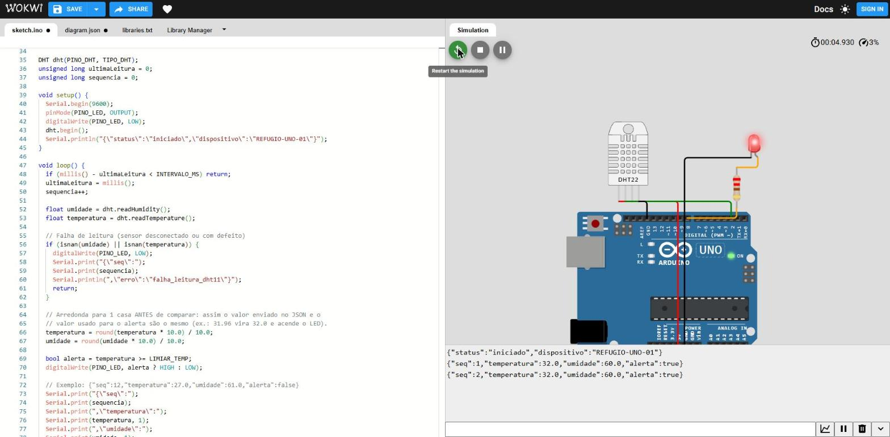
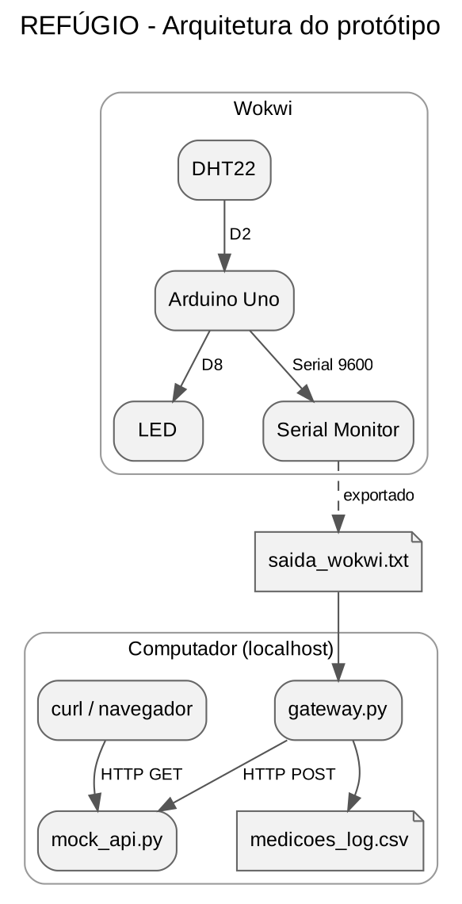
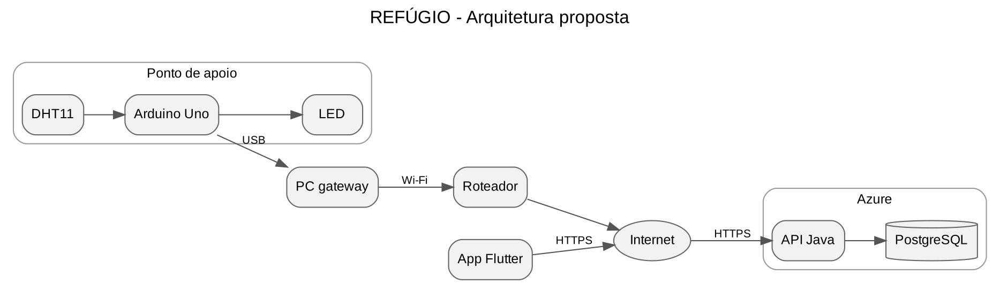

# REFÚGIO – Protótipo IoT

Global Solution 2026/2 – CitizenTech
Disciplina: Disruptive Architectures: IoT, IoB & Generative IA

Simulação no Wokwi: https://wokwi.com/projects/480550298121861121

## Integrantes

| Nome | RM |
|---|---|
| Gabriel Rocha de Souza | 567023 |
| Luiz Felipe Kichimoto Valdevino | 567726 |
| Luis Fillipe Rodrigues Seripieri | 567918 |
| Guilherme Soares | 568227 |
| Gabriel Stuani | 566682 |

## Problema

Em dias de calor, quem anda a pé depende de lugares com sombra, água e assento, mas não sabe como está cada ponto antes de chegar lá. Isso afeta principalmente idosos, pessoas com mobilidade reduzida e pedestres expostos ao sol.

O público é grande: o Censo 2022 do IBGE contou 32,1 milhões de pessoas com 60 anos ou mais no Brasil, 56% a mais que em 2010. E o calor só aumenta: a OMM confirmou 2024 como o ano mais quente já registrado, cerca de 1,55 °C acima da média pré-industrial.

## Solução

O REFÚGIO coloca um Arduino em cada ponto de apoio. Ele mede temperatura e umidade a cada 2 segundos e acende um LED quando a temperatura chega a 32 °C. Esse limite foi escolhido por nós para o protótipo, não é um valor oficial. Cada leitura sai pela Serial em JSON e passa por um gateway em Python, que valida e envia por HTTP para uma API.

Neste repositório estão o firmware, o circuito no Wokwi, o gateway, uma API de teste local e os testes. A API Java, o banco PostgreSQL na Azure e o app Flutter fazem parte da arquitetura proposta e ficam em outros trabalhos da GS.

## Componentes e por que escolhemos

- **Arduino Uno:** é a placa usada na disciplina e tem bibliotecas prontas para o DHT.
- **DHT11 (físico) / DHT22 (Wokwi):** medem temperatura e umidade com um único pino e são baratos. O Wokwi não tem DHT11, então na simulação usamos o DHT22. O firmware troca entre os dois pela linha `#define SIMULACAO_WOKWI`.
- **LED:** avisa quem está no ponto, mesmo sem celular.
- **Gateway no PC (USB/Serial):** o Uno não tem Wi-Fi, então o PC faz a ponte com a rede.
- **JSON e HTTP:** fáceis de ler e de testar, e são o mesmo formato que a API Java usaria.

## Circuito

| Componente | Pino |
|---|---|
| Sensor VCC | 5V |
| Sensor DATA | D2 |
| Sensor GND | GND |
| LED (com resistor de 220 Ω) | D8 |



Mais detalhes da pinagem, incluindo a dos módulos DHT11, estão em [docs/circuito.md](docs/circuito.md).

## Arquitetura e rede

O que testamos rodou todo em um computador, com o gateway e a API em `localhost`:



Na implantação completa, o caminho dos dados seria: sensor → Arduino → USB/Serial → PC gateway → roteador (Wi-Fi ou cabo) → Internet (HTTPS) → API Java na Azure → PostgreSQL. O app do cidadão consulta a API.



O Arduino envia uma linha JSON por leitura:

```json
{"seq":12,"temperatura":27.0,"umidade":61.0,"alerta":false}
```

O gateway acrescenta o ponto, a origem e o horário e faz `POST /api/medicoes`. A API responde 201 quando aceita, 400 ou 422 quando o dado é inválido e 401 sem token. Em caso de erro 5xx ou sem conexão, o gateway tenta até 3 vezes. Tudo fica registrado em um CSV.

## Como executar

**No Wokwi:** abra o link do projeto, clique em Start e veja as leituras no Serial Monitor. Clique no sensor para mudar a temperatura: a partir de 32 °C o LED acende.

**Gateway e API de teste** (Python 3.10 ou superior), na pasta `gateway`:

```bash
pip install -r requirements.txt

# terminal 1 – API de teste (guarda os dados só na memória)
python mock_api.py

# terminal 2 – envia as leituras exportadas do Wokwi
python gateway.py --arquivo ../evidencias/wokwi_2026-11-13/saida_wokwi.txt

# consultar o que chegou
curl "http://localhost:8080/api/medicoes?limite=5"
```

Com o Arduino físico, use `python gateway.py --porta COM3`. Também tem `--simular`, que gera dados aleatórios para testar o software. A configuração fica em `config.example.json`, e o token, se for usado, vem da variável `REFUGIO_API_TOKEN`.

Para rodar os testes automatizados, na pasta raiz: `python -m unittest discover -s testes -v`

## Testes e resultados

Os casos completos estão em [docs/testes.md](docs/testes.md) e os arquivos em [evidencias/](evidencias/README.md).

- **Wokwi:** testamos a leitura normal (27 °C), o calor (35 °C), a volta ao normal (25 °C), o sensor desconectado e o limite exato: 31,9 °C deixa o LED apagado e 32,0 °C acende.
- **Gateway e API:** enviamos as 39 leituras do Wokwi e as 39 foram aceitas. Testamos também entradas inválidas (recusadas sem enviar), API desligada, erro 503 temporário e as validações 400, 401 e 422.
- **Estabilidade:** com `--simular`, foram 60 leituras em 2 minutos; as 54 válidas foram entregues.
- **Automatizados:** 18 testes do gateway e da API e 11 verificações da lógica do firmware, todos passando.

As métricas por execução foram calculadas com `gateway/metricas.py`.

## Limitações

- O circuito foi testado no Wokwi, com DHT22. O modo `--arquivo` reenvia a saída copiada do Wokwi; ele não é conectado em tempo real.
- Se a API ficar fora do ar, as leituras que falharem ficam só no CSV, sem reenvio automático.
- A API de teste guarda os dados na memória e perde tudo ao fechar.
- O DHT11 tem precisão de ±2 °C e mede só o lugar onde está instalado.
- Como próximo passo, um ESP32 com Wi-Fi poderia substituir o PC gateway.

## Estrutura

```
arduino/     firmware
wokwi/       circuito e bibliotecas da simulação
gateway/     gateway, API de teste, validação e métricas
testes/      testes automatizados
docs/        circuito, testes, roteiro da apresentação e diagramas
evidencias/  prints, saídas do Wokwi, logs e métricas
```

## Fontes

- IBGE – Censo 2022, pessoas de 60 anos ou mais: https://biblioteca.ibge.gov.br/visualizacao/livros/liv102038.pdf
- OMM – 2024, ano mais quente registrado: https://wmo.int/news/media-centre/wmo-confirms-2024-warmest-year-record-about-155degc-above-pre-industrial-level
- Datasheet DHT11: https://ece-classes.usc.edu/ee459/library/datasheets/DHT11.pdf
- Datasheet DHT22: https://cdn.sparkfun.com/assets/f/7/d/9/c/DHT22.pdf
